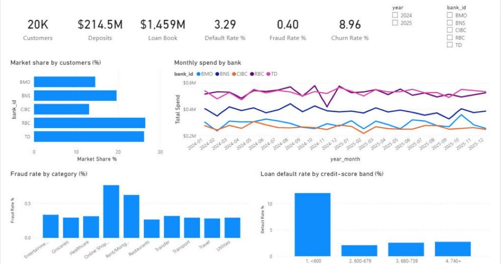
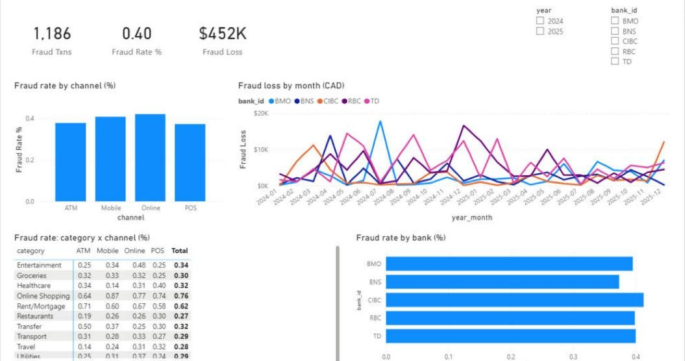
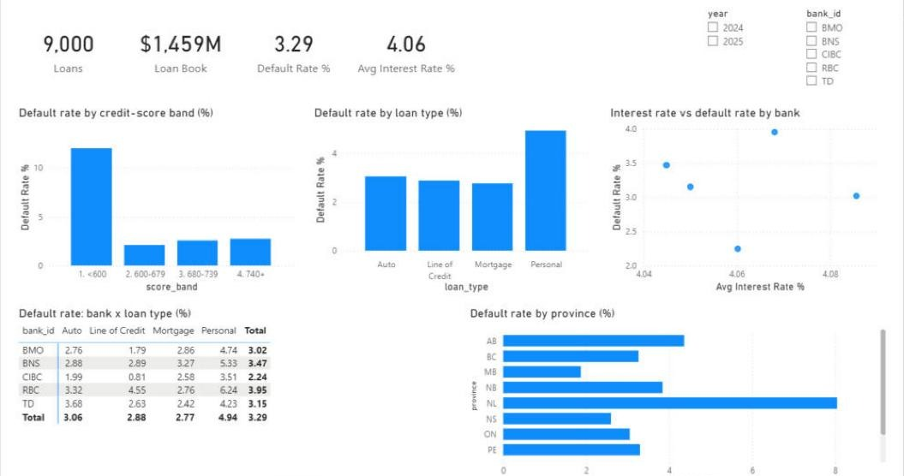
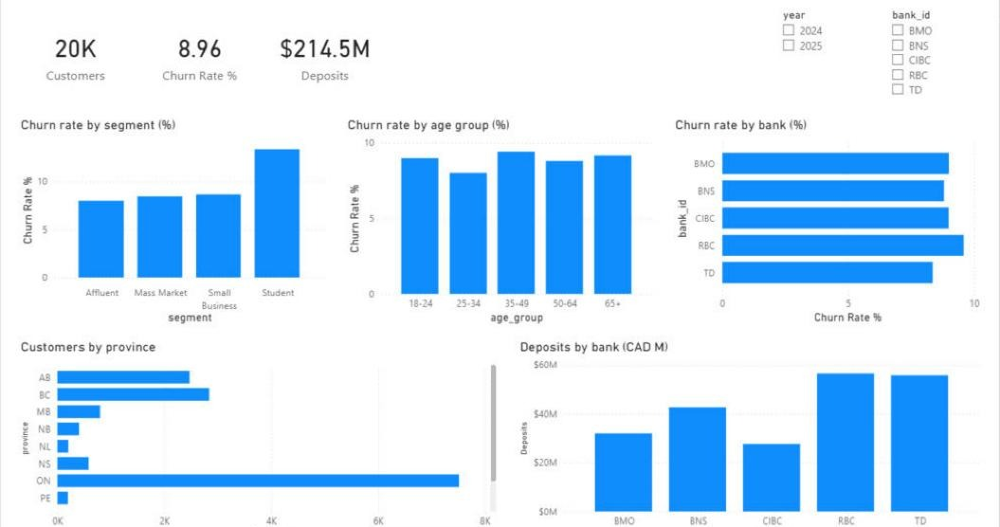
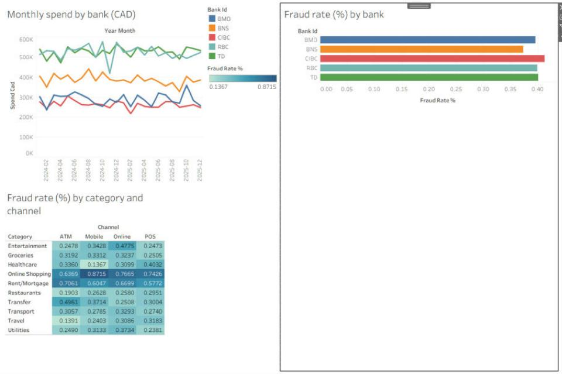
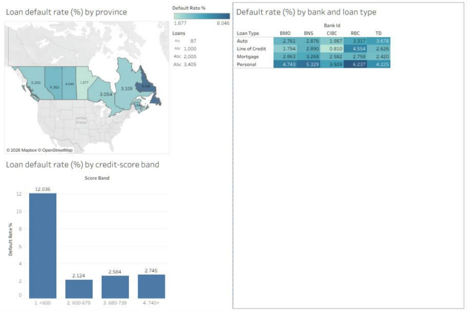

# Canada Big 5 Banks: Power BI and Tableau Dashboards

Business-intelligence project covering RBC, TD, Scotiabank (BNS), BMO and CIBC. A **PySpark** pipeline builds a star-schema data layer, which feeds a **4-page Power BI report** and **2 Tableau dashboards**.

> **Data disclosure:** Real customer data from these banks is not public. All data is **synthetic**, generated with a fixed seed by `scripts/generate_data.py` (20K customers, 40K accounts, 300K transactions, 9K loans, Jan 2024 to Dec 2025). Bank names are labels only. Differences between banks are mostly random noise by design; the realistic relationships are credit score → default, student → churn, and online/large amounts → fraud.

Companion project (PySpark / Databricks / Delta Lake / MLlib analysis on the same data): [canada-big5-banks-databricks](https://github.com/dhruvrawal/canada-big5-banks-databricks)

## Pipeline
```
scripts/generate_data.py  → data/*.csv   (synthetic, seed 42; generated locally, git-ignored)
scripts/build_bi_marts.py → bi/*.csv     (PySpark: dedupe, enrich, star schema, aggregated marts)
bi/*.csv                  → powerbi/Big5_Banks.pbip   and   Tableau Public workbook
```
`bi/` holds the 7 star-schema tables (`dim_bank, dim_branch, dim_customer, dim_account, dim_date, fact_transactions, fact_loans`) and 3 marts (`mart_monthly_spend_fraud, mart_loan_risk, mart_bank_scorecard`), so the dashboards can be opened without re-running the pipeline.

## Power BI (`powerbi/`)
`Big5_Banks.pbip` is a text-based Power BI Project (works with Git): 7-table model, 6 relationships through `dim_customer`, 16 DAX measures (fraud, default and churn rates, YoY/MoM spend, market share, deposits, loan book) and four pages: Executive Overview, Fraud Monitor, Credit Risk, Customers and Churn. Open it in Power BI Desktop and update the CSV paths as described in [powerbi/POWERBI_BUILD_GUIDE.md](powerbi/POWERBI_BUILD_GUIDE.md).






## Tableau (`tableau/`)
Two dashboards published to Tableau Public as "Canada Big 5 Banks Analytics": **Fraud and Spend** and **Credit Risk** (province default map, credit-score bands, bank × loan-type heatmap). Build steps in [tableau/TABLEAU_BUILD_GUIDE.md](tableau/TABLEAU_BUILD_GUIDE.md).




## Key findings (synthetic data)
- Loans to customers under a 600 credit score default at **12.0%** vs about 2 to 3% for higher bands.
- Personal loans default most (**4.9%** vs about 2.8% for mortgages).
- Online shopping has the highest fraud rate (about 0.77% vs 0.40% overall).
- Students churn most (**13.3%** vs about 8%).

## Reproduce
```bash
pip install numpy pandas pyspark
python scripts/generate_data.py      # writes data/*.csv
python scripts/build_bi_marts.py     # writes bi/*.csv (needs Java 17+ for Spark)
```
